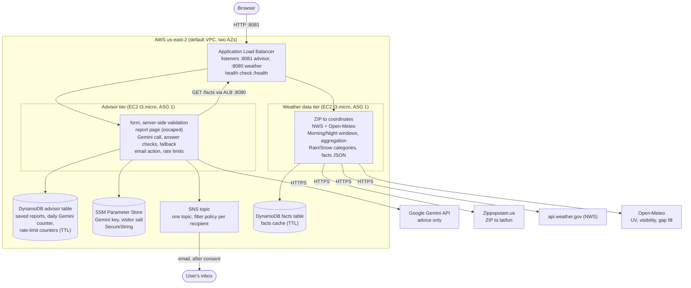

# ITMO 544 Final Project — Weather Advisor

**Dennis Osei Tutu** · Illinois Institute of Technology · Fall 2026
Repository: `github.com/Dennistutu/itmo544-cloud-computing`, folder `final_project/`

A public web application that takes a date, a US ZIP code, a clothing style and an email address, and returns ten items for the Morning and the Night of that date: five measured values, two derived categories (Rain and Snow), and three pieces of practical advice. The report can be emailed to the address that asked for it.

| # | Deliverable | Section |
|---|---|---|
| 1 | Architecture document (diagram, components, flows, data classification, decisions, threats) | [1](#1-architecture) |
| 2 | Source map and API report | [2](#2-source-map-and-api-report) |
| 3 | Report definition | [3](#3-report-definition) |
| 4 | Code | [4](#4-code) |
| 5 | Test evidence | [5](#5-test-evidence) |
| 6 | Cost report | [6](#6-cost-report) |
| 7 | Live demonstration | [7](#7-live-demonstration) |
| 8 | Reflection | [8](#8-reflection) |

---

## 1. Architecture

### 1.1 Diagram



The app security group accepts the app port (3000) **only** from the ALB's security group. No instance is reachable directly (proved by an integration test, Section 5).

Port note: the reference architecture puts the advisor on :8080 and the data tier on :8081. I kept the port numbers from my lab06 stack (weather :8080, advisor :8081). Only the numbers differ; the design is the same.

### 1.2 Components and responsibilities

| Component | Responsibility | Must not do (and how that is enforced) |
|---|---|---|
| ALB | Public entry point, `/health` checks every 10 s, forwards :8081 to the advisor and :8080 to the data tier | Expose instances directly. The app SG allows port 3000 only from the ALB SG (`stack/network.py`, tested live) |
| Advisor tier (`advisor_tier/`) | Form, server-side validation, saved reports, asks the data tier for facts, Gemini advice with answer checks and rule-based fallback, report page, SNS email, rate limits, daily Gemini cap | Call a weather API (it has no code for it and no permission). Log email or gender |
| Weather data tier (`weather_tier/`) | ZIP + date → normalized facts for Morning and Night, from NWS and Open-Meteo, with a DynamoDB cache and a stale copy for outages | Call Gemini, send email, or see the user's gender or address (it only receives `zip` and `date`) |
| DynamoDB (2 tables) | Facts cache; saved reports; daily Gemini counter; rate-limit counters. On-demand, TTL `expires_at` on every item, point-in-time recovery off | Keep personal data: no email or gender is ever written (tested) |
| SSM Parameter Store | Gemini API key and a per-deployment salt, both SecureString | Be readable by the weather role (tested with the IAM simulator) |
| Gemini API | Writes the three advice items from the facts and a clothing category | Supply a number. Answers containing a measurement are rejected (`advice.check_answer`) |
| SNS | One topic; each email subscription carries a filter policy for its own recipient tag | Deliver one person's report to another (filter policy + per-recipient tag on publish; tested) |
| Python stack (`stack/`, `create_stack.py`, `delete_stack.py`) | Creates and deletes every resource idempotently; generates the Python boot script | Contain a shell command, a `.sh` file or a hand-run step |

### 1.3 Request flow: building a report

| Step | What happens | Where |
|---|---|---|
| 1 | The user submits date, ZIP, clothing style and email | Browser → ALB :8081 → advisor |
| 2 | Per-connection rate limit (60 per 10 min), then every field is validated on the server. A bad field re-shows the form with a clear, escaped message. A non-US code is refused here, before any outside call | Advisor (`validation.py`) |
| 3 | If a saved report for the same ZIP, date and clothing category exists and is under 30 min old, it is shown at once | Advisor, DynamoDB |
| 4 | Otherwise the advisor calls `GET /facts?zip=&date=` on the data tier through the ALB (25 s limit) | Advisor → ALB :8080 → data tier |
| 5 | The data tier returns cached facts if under 30 min old; else ZIP → coordinates (Zippopotam.us), NWS `/points` (time zone, grid), then NWS griddata and Open-Meteo **in parallel** (6 s limit each), builds Morning/Night facts and categories, caches them | Data tier, outside APIs, DynamoDB |
| 6 | The advisor reserves one call from the daily Gemini cap (atomic DynamoDB update), reads the key from SSM, and sends Gemini only the computed facts and the clothing category | Advisor → Gemini |
| 7 | The answer is checked (JSON shape, exact keys, types, length, no markup or links, no measurements). Any problem → rule-based advice, labelled | Advisor (`advice.py`) |
| 8 | The report is saved for 30 min (not if any source was missing) and rendered with every value labelled with its source | Advisor, DynamoDB |

### 1.4 Request flow: emailing a report

| Step | What happens |
|---|---|
| 1 | The user presses "Email this report to …" (the address from the form, in a hidden field, re-validated) |
| 2 | Two limits: 30 per hour per connection, 3 per hour per recipient address (hashed). The saved report must still exist |
| 3 | The advisor looks for this address's subscription on the topic. None → `Subscribe` with a filter policy for its tag; the page says "waiting for confirmation" and explains what to do. Pending → same message, nothing sent |
| 4 | Confirmed → `Publish` with exactly one message attribute, the recipient's tag. SNS delivers only to the subscription whose filter matches |
| 5 | The page shows **sent** (only after SNS returned a MessageId), **waiting for confirmation**, or **not sent** with an honest reason |

The email address is never sent to Gemini, never written to DynamoDB, and never logged (tested by `test_no_email_or_gender_in_logs`, `test_saved_report_does_not_contain_email`).

### 1.5 Data classification (where each kind of data comes from)

| Kind | Items | Source | Enforced by |
|---|---|---|---|
| Measured / forecast values | Temperature, wind speed, visibility, UV, humidity, rain and snow amounts and chance | NWS and Open-Meteo only | Only `weather_tier/facts.py` produces numbers; the page renders the data tier's values, never the model's |
| Derived categories | Rain and Snow: Heavy / Mild / No | My code, published thresholds (Section 3.3) | `facts.categorize`, boundary-tested |
| Advice | Road conditions, dressing, accessories | Gemini given the facts; rule-based fallback in my code | `advice.check_answer` rejects numbers with units, markup, links, wrong shape |
| Personal input | Email, clothing style | The user | Email: only to SNS. Clothing style: turned into a category before use; never stored with the email; neither is logged |

### 1.6 Decision table

| # | Decision | Options considered | Chosen | Why |
|---|---|---|---|---|
| 1 | Tiers | One merged tier; two tiers; three (separate email worker) | **Two tiers**: advisor and weather data | Separate permissions are the main gain: the data tier cannot read the Gemini key or send mail (proved with the IAM simulator), and the advisor holds no weather code. Each tier scales and fails independently (chaos test: weather recovered while the advisor kept serving the form). A third email tier would add an instance (~$0.01/h) for one SNS call |
| 1a | Application language | Extend the lab06 Node.js apps; rewrite in Python | **Python (Flask + Waitress)** | Almost all app logic was new. One language for app, stack, boot script and tests means one test runner (pytest), shared fixtures, and moto for AWS. Waitress is a production WSGI server with no build step |
| 2 | API for each output, and gaps | NWS only; Open-Meteo only; NWS first with a second source | **NWS griddata first, Open-Meteo for gaps** | Real responses showed NWS has no UV at all, visibility for 0–2 days only, and rain/snow amounts for only ~3 days at the Chicago office. Open-Meteo covers all fields for 7 days, needs no key, and allows 10,000 calls/day for non-commercial use. Per field and period, NWS is used when it covers every hour; otherwise Open-Meteo; otherwise "not available" with a reason (Section 2) |
| 3 | ZIP → coordinates, unknown ZIPs | Census geocoder; Zippopotam.us; a bundled ZIP file | **Zippopotam.us** `/us/{zip}` | Free, no key, one call returns place name and lat/lon. An unknown ZIP returns **HTTP 404 with `{}`** (recorded fixture `zip_00000.json`), which maps cleanly to "ZIP code not found" with no Gemini call |
| 4 | Morning, Night, time zones, DST | Server time; UTC; local time at the ZIP | **06:00–11:59 and 18:00–23:59 local time at the ZIP** | The time zone comes from the NWS `/points` response (`timeZone`, e.g. `America/New_York`). Hours are built as local wall-clock times with `zoneinfo`, so DST changes are handled by the time-zone database (tested for both 2026 changes and for Hawaii). Night ends at 23:59 so it never crosses midnight |
| 5 | Aggregation | Average; value at mid-period; range; extreme | Temperature **low–high + lowest feels-like**; wind **max sustained + max gust**; visibility **minimum**; UV **peak**; humidity **range**; rain/snow **period total + highest chance** | Users act on the worst case in the period (coldest, windiest, least visible, strongest sun). Details in Section 3.2 |
| 6 | Heavy / Mild / No | Chance only; amount only; both | **Amount drives the category; chance below 20 % forces "No"** | Rain: Mild ≥ 0.01 in (NWS measurable amount), Heavy ≥ 0.30 in (AMS heavy-rain rate). Snow: Mild ≥ 0.1 in, Heavy ≥ 1.0 in (NWS heavy snowfall rate). Chance only → at most Mild. Section 3.3 |
| 7 | Caching | No cache; cache whole page; cache facts and reports | **Facts**: key `zip#date`, fresh 30 min, kept 6 h as a stale copy. **Reports**: key `report#zip#date#clothing`, 30 min. TTL on every item | NWS updates gridded forecasts about hourly; 30 min keeps reports current while answering repeats in ~100 ms (measured). The 6 h stale copy serves outages, shown with its age. Reports with a missing source are not cached, so an outage is not replayed to others |
| 8 | Gemini call and checks | Free-text answer; JSON mode with a schema | **`gemini-3.1-flash-lite` (a setting), one call per report for both periods, JSON with a response schema, 15 s limit, 600 output tokens** | One call instead of two halves free-tier use. The answer must be JSON with exactly `morning`/`night` → `road`/`dressing`/`accessories`, strings of 1–280 characters, with no markup, braces, links or measurement (number + unit). Any failure → fallback |
| 9 | Fallback advice | Generic text; rules in code | **Rules in `advice.fallback_advice`** | Uses only facts that are present: snow → slippery roads; heavy rain → standing water; feels-like ≤ 34 °F with precipitation → ice; poor visibility → low beams; gusts ≥ 30 mph → crosswinds; clothing by feels-like bands (< 32, < 50, < 65 °F); umbrella, gloves, sunscreen (UV ≥ 3). Labelled "Rule-based advice" with the reason |
| 10 | SNS or SES; consent and privacy | SES (HTML, but sandbox: every recipient must be verified); SNS topic per recipient; one SNS topic with filter policies | **One SNS topic, filter policy per subscription** | Consent is the SNS confirmation click. A topic per recipient would need a wildcard resource in IAM; one topic keeps the advisor policy on one exact ARN. Each subscription filters on `recipient` = SHA-256(salt + email); each publish carries only the requester's tag. Plain-text layout, one line per period. Deleting the topic at teardown deletes every subscription, so no address remains |
| 11 | Per-tier IAM | Managed policies; inline least privilege | **Inline, exact ARNs, no wildcards** | Weather role: `dynamodb:GetItem/PutItem` on the facts table only. Advisor role: `GetItem/PutItem/UpdateItem` on its table, `ssm:GetParameter` on the key and salt, `sns:ListSubscriptionsByTopic/Subscribe/Publish` on the one topic. Each action is commented with the code line that needs it (`stack/project_policies.py`). A unit test fails on any `*`; a live test checks allowed and denied decisions |
| 12 | Abuse controls | Per-IP only; per-recipient only; both | **Per connection: 60 reports / 10 min, 30 email requests / h. Per recipient: 3 emails / h. Daily Gemini cap 200** | A class on one campus network shares one public IP, so per-IP limits must be generous or the demo blocks itself. The per-recipient limit protects any inbox regardless of who asks. IPs and addresses are stored only as salted hashes with a TTL |
| 13 | Daily cap and budget | In-memory counter; DynamoDB atomic counter | **DynamoDB `UpdateItem ... ADD count :1` with condition `count < cap`** | One atomic write, so two racing requests cannot both take the last slot (moto test with 20 threads, cap 5 → exactly 5). Budget: stack runs only during sessions; `budget.py` reports real hours from `stack_runs.json` |
| 14 | Gender | Free text; man/woman only; short list with neutral option | **Woman / Man / Non-binary or prefer not to say → womenswear / menswear / neutral** | The interface says it is used only to tailor clothing. Gemini gets only the category. It is never stored with the email and never logged (`test_no_email_or_gender_in_logs`) |
| 15 | Boot script | Bash user-data; Python user-data | **Python, generated by `stack/boot.py`, gzip-compressed** | The no-bash rule. It writes the tier's code, installs Python 3.11 and pinned libraries with `subprocess` argument lists (no shell), writes a 0600 settings file with no secrets, and starts a systemd service as `ec2-user`. Compressed size is tested to stay under EC2's 16 KB limit (advisor: 14.4 KB) |
| 16 | Instance metadata | IMDSv1 + v2; IMDSv2 only | **IMDSv2 required** | A forged request from the app cannot read the role's credentials with a plain GET |
| 17 | Target group deregistration delay | 300 s default; 30 s | **30 s** | Found on the first deploy: teardown and replacement waited 5 min. No request here runs longer than about 40 s |

### 1.7 Threat table

| # | Threat | Asset | Control | Evidence |
|---|---|---|---|---|
| T1 | Gemini key leaked through code, `.env`, user-data, logs or git | Gemini quota | Key only in SSM SecureString; advisor reads it at run time; user-data holds only the parameter name; `.env` and `*.pem` git-ignored | `test_no_secret_in_user_data` (moto), `test_no_secret_in_live_user_data` (live) |
| T2 | Compromised weather instance used to read the key or send mail | Key, users' inboxes | Separate role with only `GetItem/PutItem` on the facts table | IAM simulator: weather role denied `ssm:GetParameter`, `sns:Publish` |
| T3 | Direct access to an instance, bypassing ALB controls | App instances | App SG allows 3000 only from the ALB SG | `test_app_port_not_reachable_directly` (live TCP connect fails) |
| T4 | Credential theft through the metadata service | Role credentials | IMDSv2 required | `test_instances_require_imdsv2` |
| T5 | Prompt injection through user input | Advice integrity | Only fixed values reach the model: computed facts and one of three categories. No user text, ZIP, place name or email | `test_prompt_contains_only_facts_and_category`, `test_prompt_rejects_free_text_category` |
| T6 | Model invents numbers or returns hostile text | Report accuracy, visitors' browsers | Answer schema + checks (shape, types, length, no markup/links/measurements); Jinja autoescaping; the page renders data-tier numbers only | 15 bad-answer cases in `test_bad_answers_rejected`; `test_input_is_escaped_when_echoed`; live `test_hostile_input_is_escaped` |
| T7 | Free-tier exhaustion by one visitor | Gemini quota | Per-connection report limit; atomic daily cap with labelled fallback | `test_report_rate_limit`, `test_daily_cap_holds_when_requests_race`, live chaos `test_gemini_cap_reached_gives_labeled_fallback` |
| T8 | Page used to email strangers | Third parties | Mail only after the recipient's own confirmation; per-recipient and per-connection limits | `test_unconfirmed_address_never_receives_report`, `test_email_limit`, `test_email_limit_is_per_recipient_not_per_campus_ip` |
| T9 | One user receives another's report | Privacy | Filter policy per subscription; publish carries one tag | `test_two_recipients_never_see_each_others_report` (two SQS inboxes with the real filter policies) |
| T10 | Forged form fields (report key, gender, ZIP) | Data integrity | Server re-validates every field; report key must match a strict pattern | `test_email_with_forged_report_key_refused`, `test_gender_fixed_list` |
| T11 | Hostile or malformed data from a weather API | Report accuracy | Only expected fields parsed; nulls stay missing, never zero; data tier only follows `https://api.weather.gov/` links; output escaped | `test_null_values_stay_missing_not_zero`, `nws_grid` URL check, contract tests |
| T12 | Personal data kept too long | Privacy | No email or gender in DynamoDB or logs; IPs and addresses only as salted hashes in counters with TTL; topic deleted at teardown | `test_saved_report_does_not_contain_email`, `test_delete_removes_everything_but_the_key_and_is_safe_twice` (no subscriptions remain) |
| T13 | Slow dependency holds requests until the ALB times out | Availability | 6 s per outside call (3 in a row at most), 25 s to the data tier, 15 s to Gemini: 40 s < ALB 60 s. Settings validation rejects longer combinations | `test_timeouts_must_fit_inside_alb_idle_timeout` |
| T14 | Cost runaway (stack left running) | Budget | Delete every session; `budget.py` warns when a run has no stop time | `test_running_stack_is_counted_to_now_and_flagged` |
| T15 | Public data-tier listener (:8080) abused | Weather API fair use | Validated input, facts cache absorbs repeats; returns only public weather facts. Accepted risk: a production version would make the data tier internal (Reflection) | — |

---

## 2. Source map and API report

Real responses were retrieved on 2026-11-16 for ZIP 60616 (Chicago, IL), 55802 (Duluth, MN) and 33101 (Miami, FL), and saved in `tests/fixtures/` as evidence and as contract-test fixtures (`capture_fixtures.py`, summary in `tests/fixtures/SUMMARY.txt`).

**ZIP → coordinates.** Zippopotam.us `GET /us/{zip}` returns `places[0].latitude`, `longitude`, `place name`, `state abbreviation`. ZIP 00000 returns **HTTP 404, body `{}`**.

**NWS point.** `GET /points/{lat},{lon}` returns the forecast office and grid (e.g. `LOT/76,71` for Chicago), links to the text, hourly and gridded forecasts, and the IANA `timeZone` (`America/Chicago`; `America/New_York` for Miami), which defines Morning and Night.

**What NWS returns.** The text forecast has 14 day/night periods (`temperature` °F, `windSpeed` as text like "18 to 24 mph", `probabilityOfPrecipitation`, `shortForecast`): no UV, visibility or amounts. The hourly forecast has 156 hours with temperature, dewpoint, humidity, wind and chance: no UV, visibility or amounts. **Griddata** is the richest: numeric series with units and ISO 8601 interval times in UTC.

### 2.1 Source map

| # | Output | Source, field, unit, real example | Horizon found | Resolution | Gap handling |
|---|---|---|---|---|---|
| 1 | Temperature | NWS griddata `temperature`, `wmoUnit:degC`, e.g. 10 (Chicago); `apparentTemperature` for feels-like | to Nov 24 (7+ days), all three ZIPs | 1 h intervals | Open-Meteo `temperature_2m` if NWS misses an hour; converted to °F |
| 2 | Wind speed | NWS `windSpeed` and `windGust`, `wmoUnit:km_h-1`, e.g. 14.816 | to Nov 23–24 | 1–6 h intervals | Open-Meteo `wind_speed_10m` (mph); converted to mph |
| 3 | Visibility | NWS `visibility`, `wmoUnit:m`, e.g. 16093.44 (Miami) — **1–2 days only, and no values at all for Chicago** | ≤ 2 days | irregular | **Open-Meteo `visibility`** (ft, 7 days, no nulls), converted to miles |
| 4 | UV | **Not in any NWS product** (no UV field in griddata, hourly or text) | — | — | **Open-Meteo `uv_index`** (WHO UV index), e.g. max 5.65 Miami, 2.9 Chicago |
| 5 | Humidity | NWS `relativeHumidity`, %, e.g. 54 | to Nov 24 | 1 h | Open-Meteo `relative_humidity_2m` |
| 6 | Rain | NWS `probabilityOfPrecipitation` (%, e.g. 32 Miami) + `quantitativePrecipitation` (mm) | chance to day 7; **amount to Nov 20 00:00 UTC (~3 days) at Chicago (LOT)**, 7 days at Duluth (DLH) and Miami (MFL) | 6 h (`/PT6H`) | **Open-Meteo `precipitation`** (inch) and `precipitation_probability` for hours NWS does not cover |
| 7 | Snow | NWS `snowfallAmount`, mm | **~3 days at Chicago**, 7 days at DLH and MFL | 6 h | **Open-Meteo `snowfall`** (inch) |
| 8 | Road conditions | Gemini (`gemini-3.1-flash-lite`) from the facts | — | per period | Rule-based fallback |
| 9 | Dressing | Gemini, facts + clothing category | — | per period | Rule-based fallback |
| 10 | Accessories | Gemini from the facts | — | per period | Rule-based fallback |

### 2.2 Gaps found

1. **UV is not published by the NWS API at all.**
2. **Visibility** is published for only one to two days, and not at all for some grid points (Chicago).
3. **Rain and snow amounts** reach seven days at some forecast offices but stop after about three days at others (Chicago's office LOT: last `quantitativePrecipitation` interval `2026-11-19T18:00:00+00:00/PT6H`). So NWS cannot be relied on for every ZIP and every day.

A missing value is never shown as zero. For each field and each period, the code uses NWS only if it covers **every** hour of the period, otherwise Open-Meteo under the same rule, otherwise "Not available (no forecast source covers this period)". Each value on the page is labelled with its source. The rain/snow chance and amount can come from different sources; the page shows both (e.g. `Source: Open-Meteo; chance: NWS`).

### 2.3 Why Open-Meteo (evaluation criteria, Section 5.3)

| Criterion | Open-Meteo |
|---|---|
| Field and 7-day horizon | All eight fields used, 168 hours, no nulls in the retrieved data |
| Free, key | Free for non-commercial use, no key (nothing to store) |
| Rate limits | Fewer than 10,000 calls/day, 5,000/hour, 600/minute; with a 30 min facts cache this is far above our load |
| Terms, attribution | Data under CC BY 4.0: the page and email show "Weather data: National Weather Service; Open-Meteo.com (CC BY 4.0)" and say values were converted |
| Reliability, failure | When down, the report still builds from NWS and marks UV/visibility "not available" (chaos test) |
| Units, time zones | Requested in °F, mph, inches; `timezone=auto` returns local times, converted to UTC with the NWS time zone |

### 2.4 Scope rules

- **Coverage.** NWS covers the US and its territories, so only five-digit US ZIP codes are accepted. Any other format (`M5V 3L9`, `SW1A 1AA`, four or six digits, letters, empty, very long, non-ASCII digits) is refused on the server **before any outside call**, with "This service covers US locations only. Enter a five digit US ZIP code, for example 60616." The input is never echoed unescaped. A well-formed ZIP that does not exist gets "ZIP code not found."
- **Time.** Morning, Night and the selected date are in the ZIP's local time from NWS `timeZone`; the server runs in UTC.
- **Freshness.** Facts are fresh for 30 minutes (NWS updates gridded forecasts about hourly). After that they are re-fetched; the old copy is kept up to 6 hours and used only if the sources fail, with its age shown.
- **Units.** NWS griddata is metric (°C, km/h, m, mm) and the text forecast is imperial. Everything is normalized to °F, mph, miles, inches, % and the WHO UV index.

---

## 3. Report definition

### 3.1 Periods

| Decision | Definition |
|---|---|
| Morning | 06:00–11:59 local time at the ZIP, on the selected date |
| Night | 18:00–23:59 local time at the ZIP, on the selected date (does not cross midnight) |
| Date range | Today through today + 6 in the ZIP's local time. The form pre-checks a window wide enough for every US time zone (UTC−11 to UTC+10); the data tier then checks the exact window and replies "Choose a date from today to 6 days ahead" |
| Today, late in the day | Allowed. Hours already past are dropped: a partly passed period is labelled "from HH:MM"; a fully passed period shows "Not available (this period has already passed)" for each item, and the advice does not use it |
| DST | Hours are built as local wall-clock times, so 2026-11-01 Morning is 12:00–17:00 UTC (CST) and 2026-10-31 is 11:00–16:00 UTC (CDT). Tested |

### 3.2 Aggregation (one value per period)

| Item | Shown | Why |
|---|---|---|
| Temperature | Low–high °F and the lowest feels-like °F | The range shows how the period changes; the lowest feels-like value drives the dressing advice (wind chill) |
| Wind speed | Highest sustained wind and highest gust, mph | Gusts matter for driving and walking; both are shown |
| Visibility | Lowest value, miles; **poor** below 3 miles | The worst moment is what matters for driving. 3 miles is the FAA boundary between marginal and instrument conditions, a clear published line |
| UV | Peak value and WHO level (Low < 3, Moderate 3–5, High 6–7, Very high 8–10, Extreme ≥ 11) | Sun protection depends on the peak. At night UV is a real measured 0 (Low), not missing, and the advice does not suggest sunscreen |
| Humidity | Range % | Humidity changes a lot over a period; a range is honest |
| Rain | Category, period total in inches, highest chance % | Total and chance together feed the category (3.3) |
| Snow | Category, period total in inches, highest chance % | Same rule with snowfall amount |

Accumulated amounts given for longer intervals (NWS 6-hour blocks) are spread evenly over their hours and summed over the period's hours; instantaneous values hold for every hour of their interval.

### 3.3 Heavy, Mild and No

| Category | Rain (period total) | Snow (period total) |
|---|---|---|
| No | < 0.01 in, or highest chance < 20 % | < 0.1 in, or highest chance < 20 % |
| Mild | ≥ 0.01 in and < 0.30 in | ≥ 0.1 in and < 1.0 in |
| Heavy | ≥ 0.30 in | ≥ 1.0 in |

Sources:
- **Rain:** the American Meteorological Society glossary classifies rain as light up to 0.10 in per hour, moderate 0.11–0.30 in per hour, and heavy over 0.30 in per hour. 0.01 in is the smallest measurable amount in NWS reports.
- **Snow:** NWS spotter guidance gives "snowing at 1 inch per hour" as a heavy snowfall rate. 0.1 in is the smallest measurable snowfall.
- **Chance:** NWS forecasts do not mention precipitation below 20 % ("slight chance" starts at 20 %).

Forecast amounts arrive in 6-hour blocks, so the hourly rate inside a period is unknown. I apply the one-hour heavy boundaries to the period total, the conservative reading: if that much falls in the period, it was at least that heavy for an hour on average over some part of it.

**Combining chance and amount.** Chance < 20 % → No, even if a trace amount is forecast. Amount known → category from the amount. Only the chance known (≥ 20 %) → Mild, with the note "chance only; amount not forecast" (never Heavy without an amount). Neither → "Not available". Values are rounded to 3 decimals before comparison, so 7.62 mm is exactly 0.300 in. Tested exactly on, just below and just above every boundary.

### 3.4 The three advice items

| Item | Inputs sent to Gemini (per period) | Fallback rules (own code) |
|---|---|---|
| Suggested road conditions | rain, snow, temperature/feels-like, visibility (+ poor flag), wind and gust | snow → slippery; heavy rain → standing water; mild rain → wet roads; feels-like ≤ 34 °F with precipitation → ice; poor visibility → low beams; gust ≥ 30 mph → crosswinds |
| Suggested dressing | temperature, feels-like, wind, humidity, rain, snow, clothing category | feels-like < 32 heavy coat, hat, gloves; < 50 warm jacket; < 65 light jacket; else light clothing; examples per category; waterproof layer if rain or snow |
| Suggested accessories | rain, snow, UV, temperature, wind | umbrella (rain); gloves, scarf (snow or < 32 °F); sunscreen and sunglasses (UV ≥ 3); a light or reflective item at night |

Missing facts are sent as `null` with the instruction not to rely on them; the fallback also checks for missing values (e.g. "Temperature data is not available; dress in layers you can adjust").

**Gender.** The form offers Woman, Man, and Non-binary / prefer not to say, and states it is used only to tailor clothing and is not stored with the email. Gemini receives `womenswear`, `menswear` or `neutral`. Neither the choice nor the email appears in DynamoDB or the logs.

---

## 4. Code

| Path | Contents |
|---|---|
| `weather_tier/` | `facts.py` (periods, conversion, source choice, aggregation, categories; pure), `sources.py` (HTTP with time limits), `service.py` (Flask `/health`, `/facts`, cache, stale copy, fault switch for chaos tests) |
| `advisor_tier/` | `validation.py`, `advice.py` (prompt, answer checks, fallback; pure), `store.py` (reports, atomic counters), `emailer.py` (SNS consent and delivery), `templates.py` (autoescaped), `service.py` (routes) |
| `stack/` | `project_config.py` (settings from `.env`), `project_policies.py` (IAM documents; pure), `boot.py` (Python boot script generator; pure), `data_stores.py`, `project_stack.py` (ordered create/delete), shared lab modules (`network`, `balancer`, `scaling`, `compute`) |
| `create_stack.py`, `delete_stack.py` | Build everything from nothing; delete everything except the Gemini key. Both idempotent |
| `store_gemini_key.py` | Stores the key in SSM after one test call (hidden input, never printed) |
| `budget.py` | Cost report from the run log |
| `capture_fixtures.py`, `summarize_fixtures.py` | Record and summarize real API responses |
| `tests/unit/` | Offline unit, moto and contract tests |
| `tests/integration/` | `test_live.py` (integration), `test_chaos.py`, `test_sli.py` |

Order of creation: Gemini key check → tables, topic, salt → roles (exact ARNs) → network and SGs → target groups, ALB, listeners → launch templates (Python boot scripts with the ALB address) → Auto Scaling Groups. Deletion runs in reverse and keeps only the Gemini key.

---

## 5. Test evidence

### 5.1 Offline tests (no AWS credentials, no network)

`python -m pytest -q` → **210 passed, 29 deselected** (the 29 are the live tests). Screenshot: `screenshots/01-unit-tests.png`.

| Layer | Files | Covers |
|---|---|---|
| Unit, application logic | `test_facts.py`, `test_advisor_logic.py` | Every validation rule and boundary, with the table of refused non-US codes and accepted ZIPs; periods across time zones and both 2026 DST changes; aggregation; Rain/Snow thresholds on and around each boundary; Gemini answer checks (good, malformed, wrong types, too long, hostile, invented measurements); escaping; fallback advice |
| API contract | `test_contract_fixtures.py` | Real recorded responses for Zippopotam.us (incl. 404), NWS points, NWS griddata, Open-Meteo; a response with a missing field in both sources → "not available", not zero |
| Unit with moto | `test_project_stack.py`, `test_weather_service.py`, `test_advisor_service.py` | Tables (TTL, on-demand, no PITR), IAM documents (no wildcards; deployed = documented), full create and delete, create twice (no duplicates, salt kept), delete twice, refuse to start without the key, IMDSv2, `/health` checks, boot script is Python and < 16 KB; daily cap with **20 racing threads, cap 5 → exactly 5** |
| Email | `test_advisor_service.py` | Consent state machine (pending → sent), unconfirmed address never published to, service error reported honestly, limits per connection and per recipient, **two recipients never see each other's report** |

### 5.2 Integration tests (live stack)

`python -m pytest -m integration -v` → **19 passed in 24 s**. Screenshot: `screenshots/08-integration-tests.png`.

Real report for ZIP 60601 and tomorrow's date; saved repeat for 60602; five non-US formats refused by the server (HTTP 400); `00000` → 404; hostile input escaped; date outside the window refused; both target groups healthy; `/health` through the ALB on both ports; **port 3000 not reachable on either instance's public IP**; app SG allows port 3000 only from the ALB SG; **IAM simulator: 16 allowed/denied decisions as designed**; no Gemini key in the live launch templates; tables with TTL and no backups.

### 5.3 Measured response times (SLI / SLO)

`python -m pytest -m sli -v -s`, from my workstation in Chicago to us-east-2 (results also in `evidence/sli_results.md`). Screenshot: `screenshots/09-sli-slo.png`.

| SLI | n | p50 (ms) | p95 (ms) | max (ms) | SLO (ms) | within SLO | result |
|---|---|---|---|---|---|---|---|
| weather /health | 50 | 34.9 | 41.8 | 46.8 | 120 | 100.0% | PASS |
| advisor /health | 50 | 33.1 | 46.5 | 49.9 | 120 | 100.0% | PASS |
| saved report (cache) | 20 | 51.9 | 105.3 | 105.3 | 120 | 100.0% | PASS |
| saved report (cache) | 20 | 51.9 | 105.3 | 105.3 | 3000 | 100.0% | PASS |
| new report (NWS + Open-Meteo + Gemini) | 5 | 2685.7 | 3518.1 | 3518.1 | 20000 | 100.0% | PASS |

An SLI is a measured value (here, response time per request type); an SLO is the target for it. I report p95 rather than the average, because an average hides the slow requests users notice. The 120 ms course SLO is met by the health checks and by saved reports. A new report waits on three outside services and is measured against the guide's 20 s target.

### 5.4 Chaos tests

`python -m pytest -m chaos -v -s` → **6 passed in 4 min 24 s**. Screenshot: `screenshots/10-chaos-tests.png`.

| Test | What was broken | What the user saw / what happened |
|---|---|---|
| Gemini cap | Today's counter set to the cap (200) | Report with "Rule-based advice (Gemini not used: daily limit reached)"; log line `gemini_fallback reason=cap` |
| One source down | Open-Meteo switched off | Report still built; UV and visibility "Not available (no forecast source covers this period)"; other items from NWS; not cached |
| All forecasts down, nothing cached | NWS griddata and Open-Meteo off | "Weather data is unavailable right now. Please try again shortly." (HTTP 503). No invented values |
| All sources down, old copy cached | Every source off; cached facts aged 60 min | Report from the stale copy, marked "weather sources unavailable; showing data 60 minutes old" |
| **Advisor instance terminated** | `TerminateInstances` on the healthy target | **Healthy again after 164 s** (SLO 180 s). PASS |
| **Weather instance terminated** | Same for the data tier | **Healthy again after 93 s** (SLO 180 s). PASS |

Sources are switched off by writing a short-lived item (`chaos#sources`, 5-minute TTL) into the facts table. Only the operator's account can write it; visitors cannot. Recovery is dominated by the new instance installing Python 3.11 and the libraries at boot, as in my week 7 lab where install time dominated. Nothing is lost on instance loss because no state lives on the instances.

### 5.5 Manual evidence from the live deploys

| Screenshot | Shows |
|---|---|
| `00-setup.png` | `final_project` created from the week 9 baseline, venv rebuilt, SNS permission added |
| `02-create-stack.png` | `create_stack.py` building all seven stages; role permissions printed |
| `03-targets-healthy.png` | Both target groups healthy (Python boot script worked) — captured at the dress rehearsal |
| `04a-form.png` | The form with the privacy note (what is sent to Google) |
| `04b-report.png`, `04c-report.png` | Chicago 60616 report: all ten rows, Morning and Night, sources, Gemini advice, email button |
| `05a-email-pending.png` | "Email: waiting for confirmation" before consent — captured at the dress rehearsal |
| `05b-email-sent.png` | "Email: sent" after the address confirmed |
| `05c-email-received.png`, `05d-email-received.png` | The report received in Gmail from AWS Notifications (first-deploy layout, before the one-line-per-period fix) |
| `06a-non-us-refused.png` | `M5V 3` refused in the browser: "This service covers US locations only" |
| `06b-non-us-refused-curl.png` | Full `M5V 3L9` sent straight to the server with `curl`, bypassing the browser: refused |
| `06c-zip-not-found.png` | `00000` → "ZIP code not found" |
| `07-delete-stack.png` | Everything deleted except the Gemini key |

Found on the first deploy and fixed: (1) the 300 s deregistration delay made teardown slow → 30 s; (2) the email table did not line up in Gmail's proportional font → one line per period; (3) the ZIP box's 5-character limit hid the full foreign code from the server → 10 characters; (4) per-IP limits would block a whole class behind one campus IP → per-recipient email limit; (5) deleting ASGs one after another doubled teardown time → both deleted together.

---

## 6. Cost report

Output of `python budget.py` after the second session (screenshot `screenshots/11-budget.png`):

```
Weather Advisor - cost report
========================================================================
 #  created              deleted               hours    cost  Gemini
 1  2026-11-17 08:51 UTC 2026-11-17 10:00 UTC   1.16   0.081       0
 2  2026-11-18 19:45 UTC 2026-11-18 20:42 UTC   0.95   0.067      10
------------------------------------------------------------------------
    TOTAL                                       2.11   0.148      10

Stack rate:          $0.070 per hour
Gemini, DynamoDB, SSM, SNS, weather APIs: $0.00 (see notes)
Total spent:         $0.15 of $2.00 (7%)
Remaining:           $1.85  (about 26.5 more stack hours)
```

| Item | Cost basis | Spent |
|---|---|---|
| Stack (ALB, 2 × t3.micro, public IPv4) | ~$0.07/hour × real hours from `stack_runs.json` | $0.15 |
| Gemini | Free tier; capped at 200 calls/day | $0.00 |
| NWS, Zippopotam.us, Open-Meteo | Free | $0.00 |
| DynamoDB on-demand, SSM standard, SNS email | A few hundred requests per session | < $0.01 |
| **Total** | | **$0.15 of $2.00** |

Notes: run 1 shows 0 Gemini calls because counting at teardown was added after that session; it made at least one Gemini call. The final totals including the dress rehearsal and the live demonstration will be added after December 1.

---

## 7. Live demonstration

Plan (about 15 minutes, budget about $0.03):

1. `python create_stack.py` from nothing; show the role permissions as they print. Wait for both targets `healthy`.
2. Share `http://<alb-dns>:8081/`. Produce a report for a real ZIP and tomorrow; point out the sources and the Gemini label.
3. Email it: show "waiting for confirmation", confirm on a phone, press again, show "sent" and the email.
4. Show the refusals: `M5V 3L9` (US only) and `00000` (not found).
5. **Break something on purpose:** `pytest -m chaos -k "cap or one_source"` (fallback advice and a degraded report), then terminate the advisor instance in the console and watch the ALB recover.
6. `python delete_stack.py`, then `python budget.py`.

---

## 8. Reflection

### At ten times the traffic

If the application had ten times more users, the first limits would come from outside AWS, not from AWS itself.

* **AI capacity.** The daily Gemini cap of 200 calls and the free tier's per-minute limits would run out first, and every extra user would receive the rule-based fallback advice. I would move to a paid plan with budget alerts, and cache advice by rounded weather conditions and clothing category, so that cities with similar weather reuse one Gemini answer instead of calling the API again.
* **Server capacity and recovery.** Each tier currently runs one instance, so losing an instance means a short outage: my chaos test measured 164 seconds for the advisor and 93 seconds for the data tier. I would run at least two instances per tier across both Availability Zones, with scaling based on request count, so one failure no longer interrupts users. I would also build an AMI with Python and the libraries already installed, because installing them at boot is most of the recovery time.
* **Weather caching and abuse.** I would cache weather by NWS forecast grid cell instead of by ZIP code, because many ZIP codes share one grid cell. This reduces calls to NWS, which asks clients to be considerate. My rate limits are per IP address, which is weak when many users share one network (a whole class on campus shares one public IP), so I would add a CAPTCHA to the form to stop automated requests.

### Before real-world use

Before opening the application to the public, I would focus on security, reliability and privacy.

* **Network security.** I would add HTTPS on the load balancer with an AWS Certificate Manager certificate and redirect HTTP to HTTPS. The data tier's listener is currently public on the ALB; I would move it behind an internal load balancer in private subnets so only the advisor tier can reach it, and use VPC endpoints for DynamoDB, SSM and SNS so this traffic does not cross the internet.
* **Email delivery.** I would switch to Amazon SES with a verified domain and production access, so the report can be sent as formatted HTML with a proper sender name, while keeping the consent step so no one receives mail they did not ask for.
* **Monitoring and user safety.** I would set CloudWatch alarms for unhealthy targets, server errors, the Gemini failure counter and unusual cost increases, and set log retention limits so no data is kept longer than needed. I would add a privacy notice and my own unsubscribe page. Finally, I would have the advice reviewed for dangerous conditions such as ice, heavy snow and extreme heat, where a wrong suggestion could put someone at risk.
